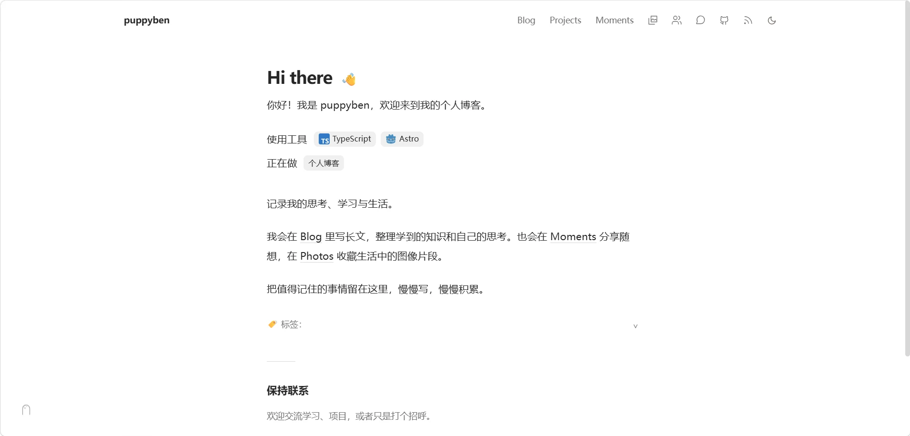
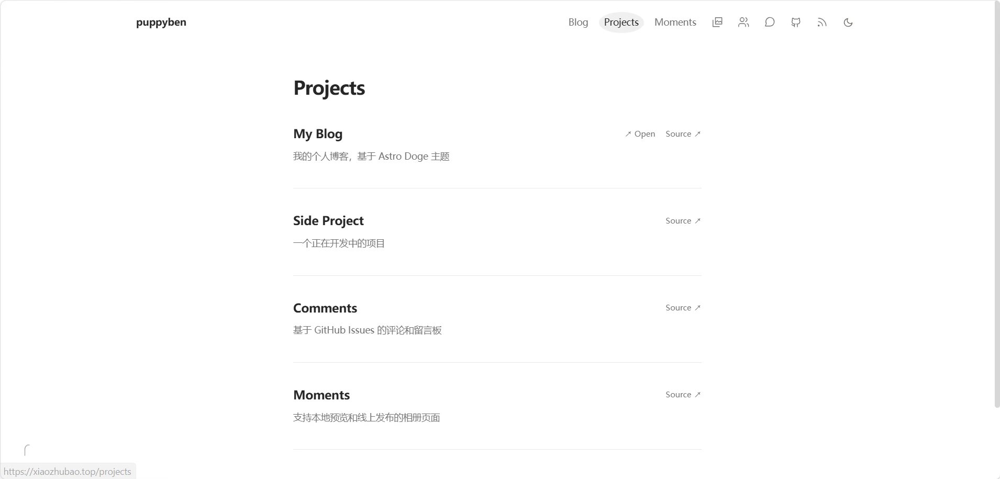
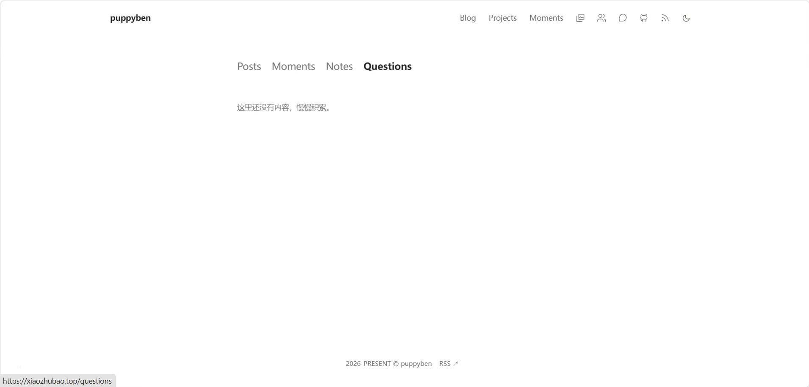

# puppyben · 个人博客

记录学习、项目与生活。基于 Astro 6、TypeScript 和 Tailwind CSS 4 构建，部署于 Vercel。

[访问博客](https://xiaozhubao.top) · [GitHub 仓库](https://github.com/puppyben1/xiaozhubao)

## 页面预览

### 首页



### 项目



### 内容分类



## 功能

- **文章**：Markdown / MDX 写作，支持 Posts、Notes、Questions 分类、搜索、目录和 RSS。
- **生活记录**：Moments 碎碎念、Photos 相册，以及 `/memory` 回忆桌面。
- **阅读体验**：响应式布局、浅色与深色主题、图片灯箱。
- **私人管理**：手动访问 `/admin` 登录，发布文章、碎碎念和照片。
- **图片上传**：文章编辑器支持选择文件或粘贴图片，自动压缩并插入正文。
- **匿名评论**：只填写评论内容即可留言或回复，评论存储于 GitHub Issues。

## 本地开发

使用 Node.js 24 和 npm，在本仓库根目录执行：

```sh
npm ci
npm run dev
```

默认访问 `http://localhost:4321`，实际地址以终端输出为准。构建检查：

```sh
npm run build
```

网站名称、简介、社交链接与项目列表在 [`src/consts.ts`](./src/consts.ts) 中修改。

## 写作与发布

访问 [`/admin`](https://xiaozhubao.top/admin) 并登录，再进入对应编辑页面：

| 内容   | 编辑地址        | 仓库中的存储目录        |
| ------ | --------------- | ----------------------- |
| 文章   | `/posts/new`    | `src/content/posts/`    |
| 碎碎念 | `/thoughts/new` | `src/content/thoughts/` |
| 相册   | `/photos/new`   | `src/content/albums/`   |

也可以直接编辑上述目录中的 Markdown 文件。

网页发布会自动把内容提交到 GitHub 的 `main` 分支，由 Vercel 重新构建上线。图片默认写入 `public/uploads/`，上传成功后会插入正文；文章发布并完成部署后展示更新。

评论写入 GitHub Issues，不需要重新部署。`/memory` 中的生活数据保存在当前浏览器，不跨设备同步，详见 [回忆桌面说明](./MEMORY-DESKTOP.md)。

## Vercel 部署

导入 `puppyben1/xiaozhubao`，框架选择 Astro，Root Directory 保持仓库根目录。仓库已配置 Node.js 24、`npm ci` 和 `npm run build`。

在项目环境变量中配置：

| 变量                | 用途                                             |
| ------------------- | ------------------------------------------------ |
| `SITE_URL`          | `https://xiaozhubao.top`，用于生成链接及跨域配置 |
| `ADMIN_USERNAME`    | 管理员账号，例如 `puppyben`                      |
| `ADMIN_PASSWORD`    | 管理员登录密码                                   |
| `THOUGHT_API_TOKEN` | 独立随机的服务端发布密钥                         |
| `GITHUB_TOKEN`      | 仅授权目标仓库的 Fine-grained Token              |
| `CONTENT_REPO`      | `puppyben1/xiaozhubao`                           |
| `CONTENT_BRANCH`    | `main`                                           |

GitHub Token 需要 **Contents: Read and write**；启用评论还需要 **Issues: Read and write**。评论默认使用内容仓库，也可以通过 `COMMENTS_REPO` 单独指定。

环境变量修改后需要重新部署。自定义域名在 Vercel 的 Settings → Domains 中绑定，并按提示配置 DNS。

本地密钥放入已忽略的 `.env.local`；不要将真实密码、Token 或 `.vercel`、`node_modules`、构建产物提交到仓库。其他可选设置见 [`.env.example`](./.env.example)。

## 项目结构

```text
├── docs/images/          # README 页面截图
├── public/               # 静态资源与上传图片
├── scripts/              # 内容辅助脚本与功能检查
├── src/
│   ├── components/       # 页面组件与评论区
│   ├── content/          # 文章、碎碎念与相册
│   ├── layouts/          # 页面布局
│   ├── lib/              # 共享逻辑及服务端功能
│   ├── pages/            # 页面、管理入口与 Astro API
│   ├── styles/           # 样式
│   └── consts.ts         # 个人信息与站点配置
├── astro.config.mjs
└── vercel.json
```

## 维护

由 [puppyben](https://github.com/puppyben1) 维护。

## 来源与许可

主题基于 [Astro Doge](https://github.com/dogxii/astro-doge)，页面布局参考 [dogxi.me](https://dogxi.me)。保留上游版权声明，项目遵循 [MIT 许可](./LICENSE)。
